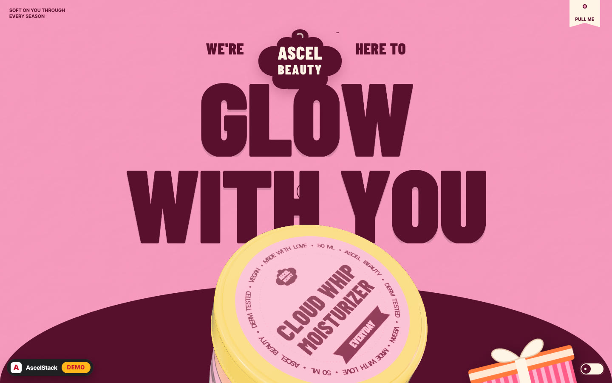
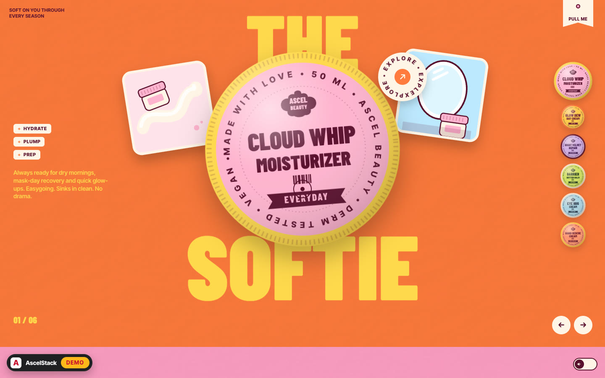
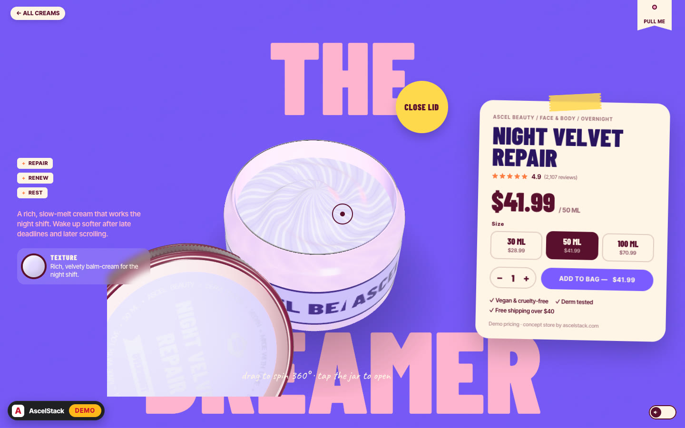
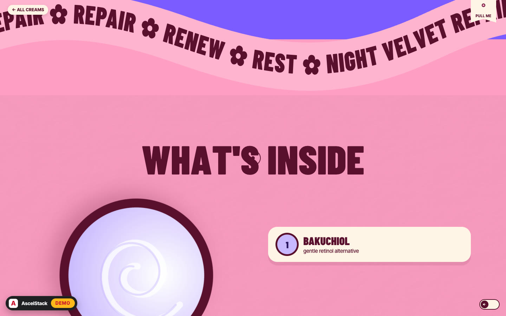
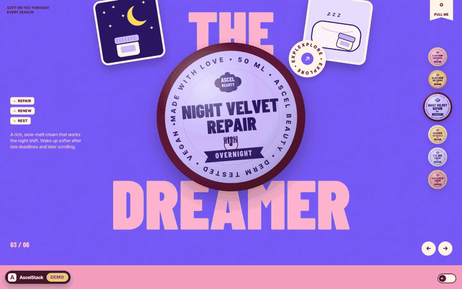
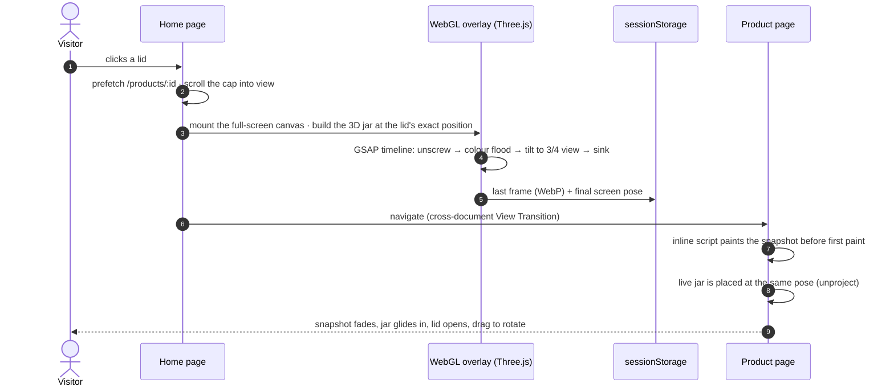
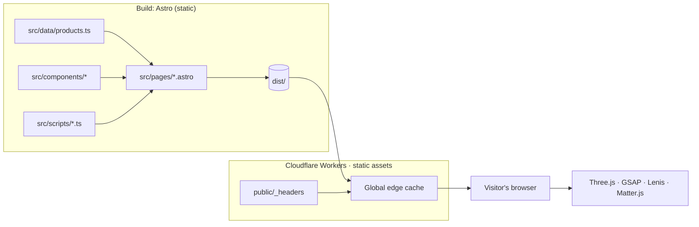

<p align="center">
  
</p>

<p align="center">
  <a href="https://ascelstack.com"></a>
  
  
  
  
  <a href="./LICENSE"></a>
</p>

<p align="center">
  <b>Ascel Beauty</b> is a concept skincare brand. It is a playful, tactile, scroll-driven storefront where every cream jar is a real-time 3D object you can spin, open and look inside.<br>
  Designed and engineered by <a href="https://ascelstack.com"><b>AscelStack</b></a> as a product demo.
</p>

> [!IMPORTANT]
> **This is proprietary software.** The source is public **for showcase only**. Copying, re-hosting, re-skinning or reusing any part of it is prohibited. See [LICENSE](./LICENSE) and [SECURITY.md](./SECURITY.md). © 2026 AscelStack. All rights reserved.

---

## ✿ The experience

<table>
  <tr>
    <td width="50%"></td>
    <td width="50%"></td>
  </tr>
  <tr>
    <td align="center"><b>Hero</b><br><sub>A 3D jar rolls down a wavy cream trail as you scroll.</sub></td>
    <td align="center"><b>The Family</b><br><sub>Six creams, six colour worlds. Pick a lid to switch the whole page.</sub></td>
  </tr>
  <tr>
    <td width="50%"></td>
    <td width="50%"></td>
  </tr>
  <tr>
    <td align="center"><b>Product page</b><br><sub>Drag to rotate 360°, tap to open the lid, then choose a size and add to the bag.</sub></td>
    <td align="center"><b>What's inside</b><br><sub>Ingredient story, how-to steps and related creams.</sub></td>
  </tr>
</table>

## ✿ The signature move: a lid that becomes a jar

Click any lid in the slider. Instead of a page load, the flat lid **turns into a real 3D jar**. The jar unscrews, tips over and sinks while the product colour floods the screen, then lands on the product page and opens to show the cream inside.

<p align="center">
  
  <br><sub>Real capture from the site (Chrome, 1440×900). <a href="docs/media/transition.mp4">MP4 version</a></sub>
</p>

<p align="center">
  
</p>

### How it works



| Piece | What it does |
| ----- | ------------ |
| **Procedural 3D jar** | Built in code with `LatheGeometry`: transmissive glass, whipped cream with a spiral displacement, a ridged lid, and canvas-drawn labels for each product. No model files to download. |
| **Pose-matched hand-off** | The overlay renders at the exact screen position, size and orientation the product page will start from. The product page re-projects the same pose, so the swap is pixel-aligned. |
| **Zero-flash navigation** | Prefetch, an inline snapshot paint and `@view-transition` together hide the browser's page swap. |
| **Scroll choreography** | GSAP ScrollTrigger handles pinning, horizontal scroll and scrubbed reveals. Lenis gives inertial scrolling. |
| **Tactile details** | Matter.js lid pile in the footer, a custom cursor, a pull-tag menu, and UI sounds synthesised with WebAudio (off by default). |
| **Respectful motion** | Honours `prefers-reduced-motion`. Every page is static HTML first. |

## ✿ Architecture



```
src/
├─ data/products.ts        six creams: colours, copy, pricing, ingredients
├─ layouts/Base.astro      <head>, fonts, AscelStack badge
├─ components/             Chrome (topbar, menu, cursor), Footer, Lid, Logo, Split…
├─ pages/
│  ├─ index.astro          home: hero, family slider, moments, CTA
│  ├─ products/[id].astro  6 statically generated product pages
│  └─ 404.astro
├─ scripts/
│  ├─ jarModel.ts          procedural 3D jar + stage
│  ├─ jar.ts               hero jar rolling on the cream trail
│  ├─ transition.ts        3D lid → jar page transition
│  ├─ product.ts           product viewer, buy box, reveals
│  ├─ main.ts · ui.ts      home choreography, Lenis, cursor, menu
│  └─ physics.ts · sound.ts
└─ styles/global.css
```

## ✿ Deploying (AscelStack team only)

The site deploys to **Cloudflare Workers** as static assets. The config is in [`wrangler.jsonc`](./wrangler.jsonc).

**Option A: GitHub connection (recommended)**

1. In the Cloudflare dashboard, go to **Workers & Pages → Create → Import a repository** and pick `ASCEL6251/ascel-beauty`.
2. Use these settings:

   | Setting | Value |
   | ------- | ----- |
   | Project / Worker name | `ascel-beauty` |
   | Production branch | `main` |
   | Build command | `npm run build` |
   | Deploy command | `npx wrangler deploy` |
   | Root directory | `/` |

3. Save and deploy. Every push to `main` then redeploys automatically, and pull requests get preview URLs.

**Option B: CLI**

```bash
npm ci
npx wrangler login
npm run deploy
```

Local evaluation: `npm run dev` (Astro dev server), or `npm run cf:dev` (production build served by Wrangler).

## ✿ License & ownership

**© 2026 AscelStack ([ascelstack.com](https://ascelstack.com)). All rights reserved.**

- Licensed under the **[AscelStack Proprietary License](./LICENSE)**. This is **not** open source.
- You may **view** this code on GitHub. You may **not** copy it, clone it into another project, re-host it, re-brand it, sell it, or use it to train AI.
- Ownership markers are embedded in the build, the HTML, the HTTP headers and the visible badge. Infringement is pursued through DMCA takedowns and legal action ([SECURITY.md](./SECURITY.md#5-enforcement)).
- Third-party libraries keep their own licences ([NOTICE](./NOTICE)).

<p align="center">
  <a href="https://ascelstack.com"></a>
  <br><sub>Want a site like this for your brand? <a href="https://ascelstack.com">Talk to AscelStack →</a></sub>
</p>
